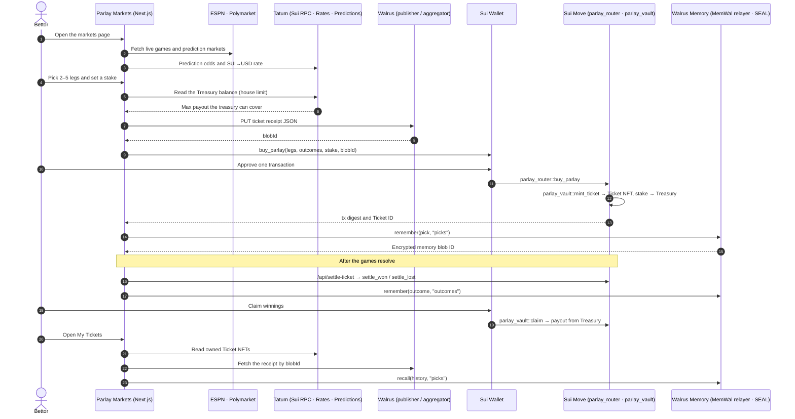

# Parlay Markets

**The first on-chain parlay on Sui.** Pick several sports or prediction-market outcomes, combine them into one ticket, and get paid only if every leg wins. Pricing, liquidity, settlement, and memory all happen on-chain — powered entirely by **Tatum** and **Walrus**.

> **Tatum × Walrus Total Recall Hackathon** · Oct 20 – Nov 10 2026
> **Track: Markets & Sports Prediction**

---

## Deployments

### Sui Mainnet

**Live:** 14 tickets minted, 4.131 SUI in the Treasury (as of Nov 9 2026).

| Object | ID / Hash |
|---|---|
| Package | [`0x9706b4bf932a2e4e27e858ea562262abe001db18121c0fd3afc6f16537f8de1d`](https://suivision.xyz/object/0x9706b4bf932a2e4e27e858ea562262abe001db18121c0fd3afc6f16537f8de1d) |
| Publish transaction | [`8m7SEHjCwgs2z9N4TKiLPUz4SaBebAGFpbx3CF8VjAXR`](https://suivision.xyz/txblock/8m7SEHjCwgs2z9N4TKiLPUz4SaBebAGFpbx3CF8VjAXR) |
| Treasury (shared) | [`0xac9d1b3282e65b9ab1c185ac5a825458a357eaaba4b546808e66e7873110e684`](https://suivision.xyz/object/0xac9d1b3282e65b9ab1c185ac5a825458a357eaaba4b546808e66e7873110e684) |
| AdminCap | [`0xf14ec005124e0384a993eea01ca801ebc4f91281bb33f396a4046b1f5e2cc03a`](https://suivision.xyz/object/0xf14ec005124e0384a993eea01ca801ebc4f91281bb33f396a4046b1f5e2cc03a) |
| UpgradeCap | [`0x7b2eeff3508cf9fe59811026d04e29f9fdf5ca987109fb181f3bf9376c3abe21`](https://suivision.xyz/object/0x7b2eeff3508cf9fe59811026d04e29f9fdf5ca987109fb181f3bf9376c3abe21) |
| Market: Man City vs Arsenal | [`0xee6bca2cf833139daba5e2041ad205e2f91590219690d933b5dc74a0168e117a`](https://suivision.xyz/object/0xee6bca2cf833139daba5e2041ad205e2f91590219690d933b5dc74a0168e117a) |
| Market: Real Madrid vs Liverpool | [`0xacb7bb61447eca9538e4676ec462e5031b5101ac4788a7de7ddefddfc3548b6f`](https://suivision.xyz/object/0xacb7bb61447eca9538e4676ec462e5031b5101ac4788a7de7ddefddfc3548b6f) |
| Market: PSG vs Bayern | [`0x3a1a25fedef1c20923b958ed5adb7f97d560daaf5b846c80e4be97334d47fcc0`](https://suivision.xyz/object/0x3a1a25fedef1c20923b958ed5adb7f97d560daaf5b846c80e4be97334d47fcc0) |
| Example Ticket NFT (3-leg NFL) | [`0x0a6a14af73f288b3532118d78692843f7cf88a20b1aa8243fa1d2d4b4b663b29`](https://suivision.xyz/object/0x0a6a14af73f288b3532118d78692843f7cf88a20b1aa8243fa1d2d4b4b663b29) |
| Example ticket mint transaction | [`Ha6gjGeiEn7Tp9n9sYKdA3ZbKfqcgmmLTd2Fizkmki4x`](https://suivision.xyz/txblock/Ha6gjGeiEn7Tp9n9sYKdA3ZbKfqcgmmLTd2Fizkmki4x) |
| Example ticket receipt (Walrus blob) | `dB3SeScRrUnKAlsi1h4xTQT_DTK8xE8ABt7WB83C7u4` |

### Sui Testnet

| Object | ID / Hash |
|---|---|
| Package | [`0x7810ac542cec4e99fb29ddcbb8aa361812c8841fb46c30809434e24f583b6351`](https://testnet.suivision.xyz/object/0x7810ac542cec4e99fb29ddcbb8aa361812c8841fb46c30809434e24f583b6351) |
| Publish transaction | [`J1L2YgCmD8o6UjgR85zF1jatFCMsP1QZYNuc2baHpG6T`](https://testnet.suivision.xyz/txblock/J1L2YgCmD8o6UjgR85zF1jatFCMsP1QZYNuc2baHpG6T) |
| Treasury (shared) | [`0x19b88bdad470ce8c21db6b6472b9847a78c0a0b1b1eb9ca5a9f554ef3776d705`](https://testnet.suivision.xyz/object/0x19b88bdad470ce8c21db6b6472b9847a78c0a0b1b1eb9ca5a9f554ef3776d705) |
| AdminCap | [`0x1fc665e69211af8554bd1a02c1a92d622647bd1311fcfa5b263a6821ff4c400e`](https://testnet.suivision.xyz/object/0x1fc665e69211af8554bd1a02c1a92d622647bd1311fcfa5b263a6821ff4c400e) |
| UpgradeCap | [`0xf45721ed7fac454d8550cf7a3218ebcf809b127dc0d8a7ded69d4cbe18d3487b`](https://testnet.suivision.xyz/object/0xf45721ed7fac454d8550cf7a3218ebcf809b127dc0d8a7ded69d4cbe18d3487b) |
| Market: Man City vs Arsenal | [`0xead2ba602ea1e787fea4237b2d580f850d6e9c20be359968db8a670486c2ac31`](https://testnet.suivision.xyz/object/0xead2ba602ea1e787fea4237b2d580f850d6e9c20be359968db8a670486c2ac31) |
| Market: Real Madrid vs Liverpool | [`0xf09d6cb36dfdcb4c71c6d97701249b0b2cbf12e2e58930292fe357155f9d42fe`](https://testnet.suivision.xyz/object/0xf09d6cb36dfdcb4c71c6d97701249b0b2cbf12e2e58930292fe357155f9d42fe) |
| Market: PSG vs Bayern | [`0x4032e307eb41a1de2888818646656b6bde6f0333a712535fa8d2150ef3579d99`](https://testnet.suivision.xyz/object/0x4032e307eb41a1de2888818646656b6bde6f0333a712535fa8d2150ef3579d99) |

### Walrus Memory (MemWal)

Memories visible at [memory.walrus.xyz](https://memory.walrus.xyz) under account `0xc6d6741ab42991fbab9b2ef91727f023b947457058a543d021f9f77f015d24d9`.

---

## What is a Parlay?

A **parlay** is a single bet made of several legs. Every leg must win. The payout multiplies across all legs — but one losing leg kills the whole ticket.

```
Single bet:   Man City wins → stake × 1.9×   (easy, low reward)

3-leg parlay: Man City wins   (0.52 odds)
            + Liverpool wins  (0.61 odds)
            + Arsenal wins    (0.58 odds)
            = 0.52 × 0.61 × 0.58 × 1.10 margin = 0.202
            → Payout: 10 SUI stake ÷ 0.202 = 49.5 SUI

Miss one leg → lose everything.
Hit all three → 4.95×.
```

Parlays are the most popular bet type at every sportsbook in the world. They have never had a good on-chain home — until now.

---

## The Problem

**On Polymarket, every call is its own bet.** Three picks means three stakes, three wallet signatures, and no combined payout. Picks at 2.05×, 2.79× and 2.21× stay three separate bets, when together they should pay **12.64×**.

**Sportsbooks instead?** They are the only place parlays exist today, and:

- **They hold your money.** Custodial accounts, withdrawals on their terms.
- **They hide the odds.** The margin is built in the dark; no one can verify how a price was made.
- **They keep your history.** Your picks and results sit in their database, not with you.
- **Win too often? They limit you.** Sharp bettors get capped or closed.

None of it is on-chain, and nobody keeps a verifiable record of who was actually right.

---

## The Solution

**One ticket.** Parlay Markets is the first parlay market on Sui: stack 2–5 picks into one on-chain ticket, with one stake and one signature, and the odds multiply.

| | Polymarket | Sportsbook | **Parlay Markets** |
|---|---|---|---|
| Legs per bet | 1 | 2+ | **2–5** |
| Wallet confirms for 3 picks | 3 | — (custodial) | **1** |
| Payout if all 3 win | 3 separate | combined | **12.64× combined** |
| Who holds the stake | you | the book | **a public Sui treasury** |
| Odds | its own book | hidden margin | **Tatum · ESPN · Polymarket, quoted before you buy** |
| Your pick history | trade log | their database | **Walrus Memory, SEAL-encrypted, yours** |
| The ticket | — | a row in their DB | **an NFT on Sui, receipt on Walrus** |
| Winning too often | — | limited | **the contract can't ban you** |

- **Tatum** powers every read: Sui RPC, the live SUI→USD rate, and prediction odds.
- **Walrus** keeps the receipt: the ticket JSON is a Walrus blob, and its blob ID is written into the NFT.
- **Walrus Memory** remembers every pick and outcome, encrypted with SEAL, so only your key can recall it.

---

## How it Works



---

## How it Fits the Track

**Track 1 — Markets & Sports Prediction**

> *"Build a prediction app for sports, elections, culture, or markets. Compare bookmaker odds with onchain sources. Track which voices were right. Users log picks before events. Memory stores credibility scores so the app learns who to trust."*

| Track requirement | Parlay Markets delivers |
|---|---|
| Prediction app for sports | Binary LMSR markets for football matches. Extendable to elections, price markets. |
| Compare bookmaker odds with onchain sources | Tatum Prediction API fetches Polymarket / Kalshi prices. UI flags when the LMSR price diverges from bookmaker by >5%. For a 3-leg parlay this spread compounds — Tatum makes it visible per leg AND for the combined ticket. |
| Track which voices were right | Walrus Memory stores win/loss per leg per user after every market resolution. |
| Users log picks before events | Parlay commitment written to Walrus Memory at buy time (before kickoff) — permanent, immutable, anchored to a Sui ticket object. |
| Memory stores credibility scores | `namespace: "credibility"` holds a trust score per user. Parlay builder and leaderboard read these scores. The app behaves differently based on what it remembered. |

**Why parlays beat single-pick apps for this track:**

A 3-leg parlay generates **4 memory data points per event** (3 individual leg results + 1 combined result). A single-pick app generates 1. The credibility system learns faster, the memory is richer, and the trust signal is stronger — a 60% hit rate on 3-leg parlays is a genuinely sharp bettor.

---

## Economics: Where the Money Comes From

This is the most important question. When a bettor stakes 10 SUI and wins 50 SUI, **where do the extra 40 SUI come from?**

**Answer: from losing bettors' stakes.**

```
10 bettors each stake 10 SUI on a ~5× parlay
─────────────────────────────────────────────
Total pool:              100 SUI

3-leg hit rate (~18%):   ~1.8 bettors win
Each winner receives:    50 SUI
Total paid to winners:   ~90 SUI

Pool keeps:              ~10 SUI  (house profit)
```

The 8 bettors who lost their 10 SUI funded the 2 winners. The house earns the 10% margin.

**House edge calculation:**

```
True combined probability:   0.52 × 0.61 × 0.58 = 0.184
Price with 10% margin:       0.184 × 1.10 = 0.202

Bettor's expected value per 10 SUI:
  = 0.184 × (10 / 0.202)  –  10
  = 0.184 × 49.5  –  10
  = 9.11  –  10
  = –0.89 SUI  (bettor loses 8.9% in expectation)

House earns 8.9% of every SUI wagered.
Over 1000 SUI total staked → house keeps ~89 SUI.
```

The 10% margin is applied to the **combined** parlay price, not each leg individually. For a 5-leg parlay the edge is higher because the margin stays fixed at 10% while the true probability shrinks.

---

## House Treasury Model

**Used in this hackathon build.** Simple, clean, and exactly how every sportsbook works.

```
┌─────────────────────────────────────┐
│          TREASURY (shared obj)       │
│          Balance: 500 SUI            │
│          (seeded by deployer)        │
└──────────────────┬──────────────────┘
                   │
       ┌───────────┼───────────┐
       │           │           │
   Bet placed  Bet lost    Bet won
   +10 SUI     (stake      –50 SUI
   into pool   stays)      paid out
```

**Flow:**

1. Deployer seeds Treasury with 500 SUI at launch — this is the float that covers early payouts.
2. Bettor buys parlay → 10 SUI stake goes into Treasury.
3. Contract checks: `treasury.balance ≥ ticket.payout_sui` (solvency guard).
4. Bettor wins → Treasury transfers 50 SUI to bettor (net: house paid 40, earned 10 margin).
5. Bettor loses → stake stays in Treasury (house keeps 10 SUI).
6. Over time: 8.9% edge means Treasury grows with volume.

**Treasury sizing:**

```
Seed:            500 SUI
Max single payout cap:    100 SUI  (enforced in contract)
Max concurrent open tickets: 5
Worst case payout:        500 SUI  ✓ covered by seed

After 100 bets of 10 SUI each (1000 SUI wagered):
  Treasury grows by: 1000 × 0.089 = +89 SUI
  New balance:       ~589 SUI
```

The deployer is the house. The house is the counterparty on every bet. This is the simplest, most auditable model.

---

## Liquidity Pool Model (Production Path)

After the hackathon, the Treasury can be opened to external liquidity providers. Anyone can deposit SUI, earn yield from losing bets, and withdraw at any time.

```
LP 1 deposits 200 SUI  ──►┐
LP 2 deposits 150 SUI  ──►│  POOL (500 SUI)
LP 3 deposits 150 SUI  ──►│
                           │◄── losing stakes add to pool
                           └──► winning payouts leave pool
```

**LP shares:**

LPs receive shares proportional to their deposit. When bettors lose, the pool grows and each share is worth more. When bettors win, the pool shrinks. Over time, the 8.9% edge means LPs earn yield.

```
LP 1 deposited 200 SUI → owns 40% of pool
After 1000 SUI wagered (pool grew by 89 SUI):
  Pool = 589 SUI
  LP 1 share = 40% × 589 = 235.6 SUI
  LP 1 profit = 35.6 SUI on 200 SUI deposit = 17.8% yield
```

**LP risk:** a string of large winners can temporarily shrink the pool. LPs bear the variance risk in exchange for yield. The 10% margin ensures positive expected return over enough volume.

**Move structs (production):**

```move
public struct Pool has key {
    id: UID,
    balance: Balance<SUI>,
    total_shares: u64,
}

public struct LpReceipt has key, store {
    id: UID,
    shares: u64,
}
```

| | House Treasury (hackathon) | Liquidity Pool (production) |
|---|---|---|
| Who provides capital | Deployer only | Anyone |
| Who earns from losses | Deployer only | All LPs proportionally |
| Complexity | Low — 1 object | Medium — shares math |
| Decentralization | Centralized | Decentralized |
| Risk | Deployer bears all | Shared across LPs |

The betting logic (buy, claim, cash-out, LMSR pricing) is identical in both models. Switching from Treasury to Pool is an additive change — `deposit()` and `withdraw()` functions plus shares tracking.

---

## Architecture

```
┌────────────────────────────────────────────────────────────┐
│  Next.js Frontend  (@mysten/dapp-kit + Slush wallet)        │
│                                                             │
│  /markets        /parlay         /tickets    /leaderboard  │
│  Tatum Pred.API  LMSR prices     Owned objs  MemWal recall  │
│  vs LMSR spread  + cred. badge   via Tatum                 │
└──────────┬─────────────────────────────────────────────────┘
           │  Tatum Sui RPC (JSON-RPC + gRPC)
           ▼
┌────────────────────────────────────────────────────────────┐
│  Sui Mainnet                                               │
│                                                             │
│  PredictionMarket (shared)   ParlayRouter    Treasury      │
│  LMSR q0/q1/b, resolve() ◄── entry point ──► (shared)     │
│                               combined price  SUI balance  │
│                               10% margin                   │
│                                    │                       │
│                                    ▼                       │
│                              Ticket (owned)                │
│                              stake, payout                 │
│                              legs[], blob_id               │
└────────────────────────────────────────────────────────────┘
           │  Tatum Prediction + Prices APIs
           ▼
┌──────────────────────────────────┐
│  Tatum Data APIs                 │
│  Prediction: events, markets,    │
│  price, pricehistory, trades,    │
│  leaderboard, wallet positions   │
│  Prices: SUI/USD, USDC/USD rates │
└──────────────────────────────────┘
           │  MemWal SDK + Walrus blobs
           ▼
┌────────────────────────────────────────────────────────────┐
│  Walrus                                                    │
│                                                             │
│  Memory (MemWal):                                          │
│    picks        parlay commitments before kickoff          │
│    outcomes     leg results after resolution               │
│    credibility  trust scores extracted by analyze()        │
│    markets      LMSR vs bookmaker spread history           │
│                                                             │
│  Blob storage:                                             │
│    ticket metadata  legs, odds, timestamp — blob_id        │
│                     anchored in Sui Ticket object          │
│    market config    team names, kickoff, source URLs       │
└────────────────────────────────────────────────────────────┘
           │
           ▼
┌──────────────────────────────────┐
│  Settlement Watcher (Node.js)    │
│  Tatum gRPC stream               │
│  MarketResolved event →          │
│    rememberBulk() outcomes       │
│    analyze() credibility update  │
└──────────────────────────────────┘
```

---

## How Tatum is Used

Tatum is the **only RPC and data layer** in Parlay Markets. Every call to Sui and every market data fetch goes through Tatum.

### RPC endpoint

```
Testnet: https://api.tatum.io/v3/blockchain/node/SUI_TESTNET/
Mainnet: https://api.tatum.io/v3/blockchain/node/SUI_MAINNET/
Auth:    x-api-key: <TATUM_API_KEY>
```

### Sui JSON-RPC — 13 methods used

| Method | Screen | Purpose |
|---|---|---|
| `sui_getObject` | Parlay builder | Read PredictionMarket → current LMSR q0/q1/b and prices |
| `suix_getOwnedObjects` | My Tickets | Fetch all Ticket objects owned by wallet |
| `sui_getTransactionBlock` | Ticket detail | Read original buy tx → show as commitment proof |
| `suix_queryTransactionBlocks` | History | Full tx history filtered by package ID |
| `sui_getEvents` | Settlement watcher | Detect MarketResolved events |
| `suix_queryEvents` | Leaderboard | Query ParlayBought + ParlaySettled events for stats |
| `suix_getBalance` | Buy flow | Check SUI balance before submit |
| `suix_getAllBalances` | Wallet panel | Show all coins in wallet |
| `sui_dryRunTransactionBlock` | Quote step | Dry-run buy tx before user signs |
| `sui_executeTransactionBlock` | Buy / claim / cashout | Submit signed transactions |
| `suix_getReferenceGasPrice` | Gas estimate | Show current gas price before signing |
| `sui_getTotalTransactionBlocks` | Stats widget | Total on-chain activity counter |
| `sui_getCheckpoint` | Settlement watcher | Confirm finality before writing to Walrus Memory |

### Sui gRPC — event streaming

The settlement watcher subscribes to `MarketResolved` events over Tatum's gRPC gateway (not polling). When an event fires: resolve the market → `rememberBulk()` outcomes → `analyze()` credibility.

### Prediction API — bookmaker vs on-chain comparison

The `/markets` page fetches Polymarket and Kalshi prices via Tatum and overlays them against on-chain LMSR prices. For a 3-leg parlay, the spread **compounds**:

```
Leg 1: LMSR 0.52 vs Polymarket 0.47  → +10.6%
Leg 2: LMSR 0.61 vs Polymarket 0.63  → –3.2%
Leg 3: LMSR 0.44 vs Polymarket 0.40  → +10.0%

You are paying 28.8% more than true market value.
⚠️  LMSR prices are significantly above market consensus.
```

| Endpoint | Purpose |
|---|---|
| `GET /v4/data/prediction/events` | Upcoming sports events for market browser |
| `GET /v4/data/prediction/events/{id}` | Event detail — teams, kickoff, status |
| `GET /v4/data/prediction/markets` | List Polymarket / Kalshi markets |
| `GET /v4/data/prediction/markets/{id}/price` | Current price to compare with LMSR |
| `GET /v4/data/prediction/markets/{id}/pricehistory` | 7-day price chart |
| `GET /v4/data/prediction/markets/{id}/trades` | Recent trades — volume, direction |
| `GET /v4/data/prediction/leaderboard` | Top traders by PnL |
| `GET /v4/data/prediction/wallets/{addr}/portfolio` | Wallet's open positions |
| `GET /v4/data/prediction/wallets/{addr}/closed` | Settled positions with outcomes |

### Prices API — dollar display

```ts
GET /v4/data/rate/batch?currencies=SUI,USDC&basePair=USD
```

Shows SUI stakes and payouts in dollar terms on every screen.

### SDK setup

```ts
import { TatumSDK, Sui, Network } from "@tatumio/tatum";

export const tatum = await TatumSDK.init<Sui>({
  network: Network.SUI_MAINNET,
  apiKey: { v4: process.env.TATUM_API_KEY! },
});
```

---

## How Walrus is Used

Walrus powers two distinct layers: **MemWal** (semantic agent memory) and **blob storage** (verifiable ticket data).

### 1. Walrus Memory (MemWal SDK)

```ts
import { MemWal } from "@mysten-incubation/memwal";

export const memwal = MemWal.create({
  key:       process.env.MEMWAL_PRIVATE_KEY!,
  accountId: process.env.MEMWAL_ACCOUNT_ID!,
  serverUrl: process.env.MEMWAL_SERVER_URL!,
});
```

**`remember()` — on parlay placement (before kickoff)**

```ts
await memwal.remember(
  `User ${address} placed 3-leg parlay at ${new Date().toISOString()}: ` +
  `MCI vs ARS (Home 0.52), LIV vs CHE (Home 0.61), TOT vs NEW (Away 0.38). ` +
  `Combined: 6.2×. Stake: 10 SUI. Ticket: ${ticketId}. Blob: ${blobId}.`,
  { namespace: "picks" }
);
```

This creates a **permanent, immutable, pre-event record** on Walrus mainnet. Even if the user deletes the app, the commitment is there.

**`rememberBulk()` — after every market resolution**

```ts
await memwal.rememberBulk(
  resolvedTickets.map(t => ({
    text:
      `User ${t.owner} parlay SETTLED: ticket ${t.id}. ` +
      `Result: ${t.won ? "WON" : "LOST"}. ` +
      `Legs: ${t.legs.map(l => `${l.market} ${l.outcome} ${l.won ? "WIN" : "LOSS"}`).join(", ")}. ` +
      `Payout: ${t.won ? t.payoutSui + " SUI" : "0"}. Stake: ${t.stakeSui} SUI.`,
    namespace: "outcomes",
  }))
);
```

**`analyze()` — credibility scoring from outcome history**

```ts
const history = await getUserHistory(address);
await memwal.analyze(
  `Betting record for ${address}: ${history.map(h => h.text).join(" | ")}`,
  { namespace: "credibility" }
);
// Walrus Memory extracts structured facts:
// "Hit rate on football Home legs: 68% (17/25)"
// "Away leg hit rate: 29% — 4-game loss streak"
// "Sharp signal: 6/8 picks beat Polymarket closing price"
// "Overall 3-leg parlay hit rate: 42%"
```

**`recall()` — in the parlay builder (changes the UI)**

```ts
const memory = await memwal.recall({
  query: `Win rate for ${address} on football Home bets`,
  namespace: "credibility",
  limit: 5,
});
// UI renders: 🟢 68% win rate on Home picks  (next to the leg)
//             🔴 29% win rate on Away picks   (warning)
```

**`recall()` — leaderboard**

```ts
const topBettors = await memwal.recall({
  query: "highest hit rate sharpest most accurate predictor",
  namespace: "credibility",
  limit: 20,
  sort: "recent",
});
```

**`recall()` — odds disagreement alerts**

```ts
const insight = await memwal.recall({
  query: `Historical odds accuracy for ${marketName}`,
  namespace: "markets",
  limit: 3,
});
```

### Memory namespaces

| Namespace | What is stored | Written by | Read by |
|---|---|---|---|
| `picks` | Parlay commitment before kickoff — legs, odds, ticket ID, blob ID | Buy flow | Proof page, pick journal |
| `outcomes` | Leg results after resolution — win/loss per leg | Settlement watcher | Credibility scorer |
| `credibility` | Structured facts from outcome history — hit rates, streaks, sharp signals | `analyze()` after each batch | Parlay builder, leaderboard |
| `markets` | LMSR price vs bookmaker price per event — spread history | Market watcher | `/markets` alert badges |

### 2. Walrus blob storage — verifiable ticket metadata

At buy time, full leg data is serialised and stored as a Walrus blob. The blob ID is embedded in the Sui Ticket object — creating a verifiable, content-addressed record.

```ts
import { WalrusClient } from "@mysten/walrus";

const walrus = new WalrusClient({ network: "mainnet" });

const metadata = JSON.stringify({
  owner: address, legs: selectedLegs,
  combinedPrice: parlayPrice, stakeSui,
  timestamp: Date.now(),
});

const { blobId } = await walrus.writeBlob({
  blob: new TextEncoder().encode(metadata),
  epochs: 52,      // ~2 years on mainnet (2-week epochs)
  deletable: false,
});

// blobId passed into buy_parlay Move call → stored in Ticket object on-chain
```

**Market config blobs** — each PredictionMarket Sui object holds a Walrus blob ID pointing to its full configuration (teams, kickoff, data source URLs). Large strings stay off-chain, verifiable via content address.

---

## The Trust and Credibility System

This is what makes Parlay Markets a **learning app**, not just a betting app.

```
User buys parlay
       │
       └─► remember() → picks namespace
           (pre-event commitment, permanent)

Market resolves (Tatum gRPC stream detects event)
       │
       ├─► rememberBulk() → outcomes namespace
       │   (leg-level win/loss for all affected tickets)
       │
       └─► analyze() → credibility namespace
           (LLM extracts structured facts per user)
                │
                └─► recall() feeds into:
                      Parlay builder  → credibility badge per leg type
                      Leaderboard     → ranked by hit rate
                      Copy-pick       → "Follow this sharp" feature
                      Proof page      → verifiable pick record
```

**What the parlay builder shows from memory:**

```
[ Manchester City  Home  0.52 ]   🟢 You win 68% of Home picks on PL matches
[ Liverpool        Home  0.61 ]   🟡 You win 51% of Home picks on LFC games
[ Tottenham        Away  0.38 ]   🔴 29% win rate — 4-game Away loss streak
                                  ⚠️  Polymarket prices this 11% lower than onchain
```

The app behaves **differently** because of what Walrus remembered. That is the judging criterion for Best Walrus Memory.

---

## Ticket as an NFT on Sui

Each parlay ticket is a **Sui owned object** — the Sui equivalent of an NFT, but better. No ERC-721 (that is an Ethereum standard). On Sui, the object lives directly in the user's wallet and holds the staked SUI inside it.

### Why Sui Objects Beat ERC-721 for Tickets

| | ERC-721 (Ethereum) | Sui Owned Object |
|---|---|---|
| Ownership | Mapping in contract storage | Object lives in your wallet |
| Funds | Separate vault contract | Ticket holds SUI balance directly |
| Display | External metadata URL | Native `Display` standard — Slush renders it |
| Gas | Expensive | Near-zero |
| Status updates | Contract call | Mutate the object in place |

### Appears as an NFT in Slush Wallet

Sui's `Display` standard tells wallets how to render the ticket:

```
┌────────────────────────┐
│  🎫 PARLAY TICKET #42  │
│                        │
│  Man City   Home  ✅   │
│  Liverpool  Home  ✅   │
│  Tottenham  Away  ⏳   │
│                        │
│  Stake:    10 SUI      │
│  Payout:   49.5 SUI    │
│  Status:   OPEN        │
└────────────────────────┘
```

The ticket status updates as legs resolve — `OPEN` → `WON` or `LOST`. After claiming, the winning ticket can be kept as a collectible trophy NFT in the wallet.

### Ticket Struct

```move
public struct Ticket has key, store {
    id: UID,
    owner: address,
    stake_sui: u64,        // SUI locked inside this object
    payout_sui: u64,
    leg_count: u8,
    legs: vector<Leg>,
    status: u8,            // 0=open 1=won 2=lost 3=cashedout
    blob_id: vector<u8>,   // Walrus blob ID for ticket metadata
    created_at: u64,
}
```

`has key` = unique on-chain ID (equivalent to a token ID).
`has store` = transferable, wrappable — user can send their ticket to a friend.

---

## Move Contracts

Fully native Sui Move. No EVM, no Solidity, no Chainlink, no 1inch.

### Module layout

| Module | File | Role |
|---|---|---|
| `lmsr` | `move/sources/lmsr.move` | Pure-math library: `cost()`, `prices()`, `price_of()` |
| `prediction_market` | `move/sources/prediction_market.move` | Shared object per event. LMSR state, resolve() |
| `parlay_router` | `move/sources/parlay_router.move` | Entry function: reads prices, computes payout, mints Ticket |
| `parlay_vault` | `move/sources/parlay_vault.move` | Ticket owned object: escrow SUI, cash_out, claim |
| `treasury` | `move/sources/treasury.move` | Shared house treasury: deposit, payout, solvency check |
| `market_resolver` | `move/sources/market_resolver.move` | AdminCap-gated resolve() |

### Key data structures

```move
// House treasury — shared object
public struct Treasury has key {
    id: UID,
    balance: Balance<SUI>,
    total_staked: u64,
    total_paid_out: u64,
}

// Binary prediction market — shared object (one per match)
public struct PredictionMarket has key {
    id: UID,
    match_id: vector<u8>,
    home_team: String,
    away_team: String,
    kickoff: u64,
    b: u64,              // LMSR liquidity parameter (WAD)
    q0: u64,             // Home units outstanding
    q1: u64,             // Away units outstanding
    result: u8,          // 0=unresolved 1=Home 2=Away 3=Draw
    blob_id: vector<u8>, // Walrus blob ID for market config
}

// Parlay ticket — owned object (one per bet)
public struct Ticket has key, store {
    id: UID,
    owner: address,
    stake_sui: u64,
    payout_sui: u64,
    leg_count: u8,
    legs: vector<Leg>,
    status: u8,          // 0=open 1=won 2=lost 3=cashedout
    blob_id: vector<u8>, // Walrus blob ID for ticket metadata
}

public struct Leg has store, drop {
    market_id: ID,
    outcome: u8,         // 0=Home 1=Away
    price_wad: u64,      // LMSR price at buy time (WAD)
}
```

---

## Walrus Memory Schema

Each memory is a plain English sentence embedded into a vector index on Walrus mainnet.

### `picks` namespace

```
"User 0x1a2b placed 3-leg parlay at 2026-11-08T18:30:00Z:
 MCI vs ARS Home (0.52), LIV vs CHE Home (0.61), TOT vs NEW Away (0.38).
 Combined: 6.2×. Stake: 10 SUI. Ticket: 0xabc. Blob: baVFr3...Qs9."
```

### `outcomes` namespace

```
"User 0x1a2b parlay LOST at 2026-11-09T22:05:00Z.
 Legs: MCI-Home WIN, LIV-Home WIN, TOT-Away LOSS.
 Leg that failed: Tottenham Away. Stake lost: 10 SUI."
```

### `credibility` namespace (extracted by analyze)

```
"0x1a2b Home pick hit rate: 68% (17/25)."
"0x1a2b Away pick hit rate: 29% (5/17) — 4-game loss streak."
"0x1a2b is sharp on Premier League: 6/8 picks beat Polymarket closing price."
"0x1a2b overall 3-leg parlay hit rate: 42% (11/26)."
```

### `markets` namespace

```
"MCI vs ARS (2026-11-09): LMSR Home 0.52. Polymarket: 0.47. Spread: +10.6%."
"LIV vs CHE (2026-11-09): LMSR Home 0.61. Bookmaker: 0.63. Spread: –3.2%."
```

---

## Repository Layout

```
move/
  sources/
    lmsr.move                 LMSR math library
    prediction_market.move    Binary market shared object
    parlay_router.move        Parlay buy entry function
    parlay_vault.move         Ticket owned object + claim/cashout
    treasury.move             House treasury shared object
    market_resolver.move      AdminCap-gated resolve
  Move.toml
frontend/
  app/
    page.tsx                  Landing
    markets/page.tsx          Market browser (Tatum Prediction API + LMSR spread)
    parlay/page.tsx           Builder (LMSR prices + MemWal credibility recall)
    tickets/page.tsx          My tickets (suix_getOwnedObjects via Tatum)
    leaderboard/page.tsx      Top bettors (MemWal recall)
  lib/
    tatum.ts                  Tatum SDK — RPC + Prediction + Prices
    memwal.ts                 MemWal client — remember/recall/analyze
    walrus.ts                 Walrus blob client — store/read ticket metadata
    contracts.ts              Package ID, shared object IDs
  components/
    BuyParlayButton.tsx       Walrus blob write + Sui tx + MemWal remember
    TicketCard.tsx            Reads Ticket via Tatum RPC
    CredibilityBadge.tsx      MemWal recall result for a leg type
    OddsCompare.tsx           Tatum Prediction API vs LMSR price
watcher/
  settlement.ts               Tatum gRPC → resolve() → rememberBulk()
  credibility.ts              Post-resolution analyze() runner
```

---

## Running it Locally

### Prerequisites

- Node.js 20+
- [Sui CLI](https://docs.sui.io/guides/developer/getting-started/sui-install)
- Sui wallet (Slush) with testnet SUI from [faucet.sui.io](https://faucet.sui.io)
- Tatum account + API key from [dashboard.tatum.io](https://dashboard.tatum.io)
- Walrus Memory account at [memory.walrus.xyz](https://memory.walrus.xyz)

### 1. Install dependencies

```bash
cd frontend && npm install
cd watcher && npm install
```

### 2. Set environment variables

```bash
cp .env.example .env.local
# Fill in values — see Environment Variables section
```

### 3. Deploy Move contracts (testnet)

```bash
cd move
sui client publish --gas-budget 200000000 --network testnet
# Note the package ID, Treasury object ID, and market object IDs
# Add them to .env.local
```

### 4. Seed the treasury

```bash
# In the Sui CLI or a deploy script
# Call treasury::init_treasury with 500 SUI
```

### 5. Run the frontend

```bash
cd frontend
npm run dev
# http://localhost:3000
```

### 6. Run the settlement watcher

```bash
cd watcher
npm run start
# Streams MarketResolved events via Tatum gRPC
# Resolves markets, writes to Walrus Memory
```

---

## Environment Variables

```bash
# Tatum (from dashboard.tatum.io; never commit real keys)
TATUM_TESTNET_KEY=
TATUM_MAINNET_KEY=

# Sui
NEXT_PUBLIC_SUI_NETWORK=testnet
NEXT_PUBLIC_PACKAGE_ID=                    # from sui client publish
NEXT_PUBLIC_TREASURY_ID=                   # Treasury shared object ID
NEXT_PUBLIC_MARKET_IDS=                    # comma-separated market object IDs

# Walrus Memory
MEMWAL_ACCOUNT_ID=0xc6d6741ab42991fbab9b2ef91727f023b947457058a543d021f9f77f015d24d9
MEMWAL_SERVER_URL=https://relayer.memory.walrus.xyz
MEMWAL_AGENT_ID=25fa6c3da25223c786cb36852d0d33789df83b1130a18b5716dcd4aa825d6c6f
MEMWAL_PRIVATE_KEY=                        # from memory.walrus.xyz dashboard
```

---

## Why This Wins

**30% — Walrus + Tatum Integration**
Every parlay placement writes to Walrus Memory (`picks`). Every settlement writes outcomes and credibility facts (`outcomes`, `credibility`). Odds disagreement is tracked per market (`markets`). Tatum powers all 13 Sui RPC methods, the gRPC settlement stream, the Prediction API for bookmaker comparison, and the Prices API.

**30% — Technical Quality**
Fully native Sui Move contracts. Tatum SDK used for all RPC and data calls with no fallback to public nodes. gRPC streaming for event watching. LMSR pricing math in Move. No EVM dependency.

**20% — Creativity**
Multi-leg parlay is a gap no other submission fills. The credibility system uses Walrus Memory to genuinely change the UI — badges, leaderboard rank, and copy-pick all depend on what the app remembered. The spread compound analysis (Tatum Prediction API vs LMSR across all legs) is a unique insight no single-pick app can produce.

**20% — Presentation**
Live on Sui mainnet. MemWal writes verified on [memory.walrus.xyz](https://memory.walrus.xyz). Blog post on dev.to covers architecture, Walrus Memory integration, and how the app learns over time.
